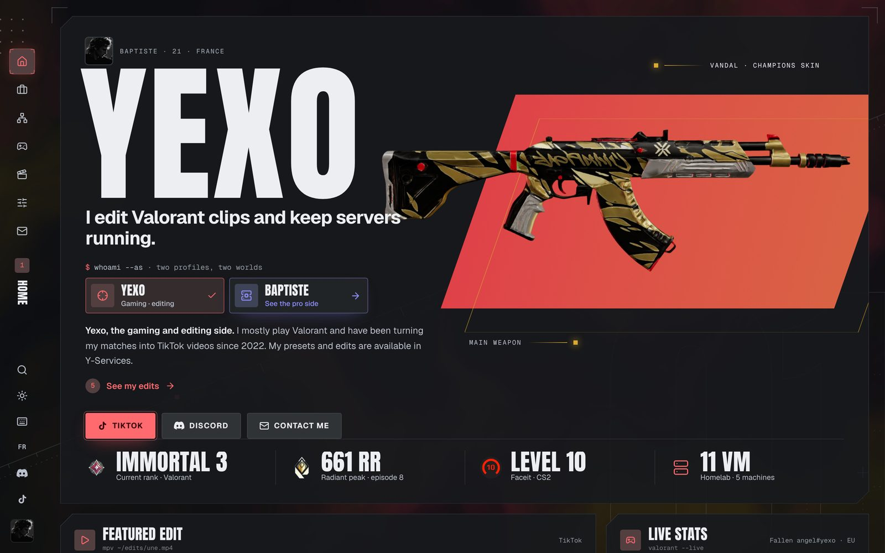
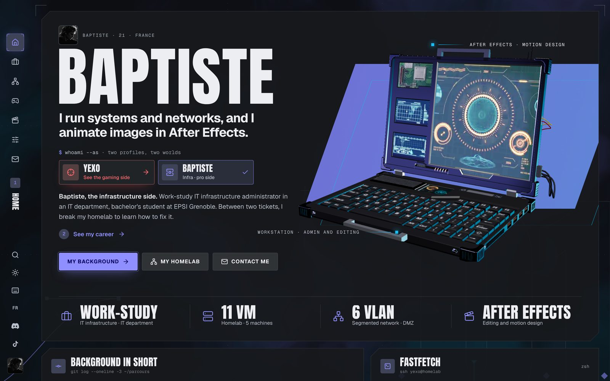
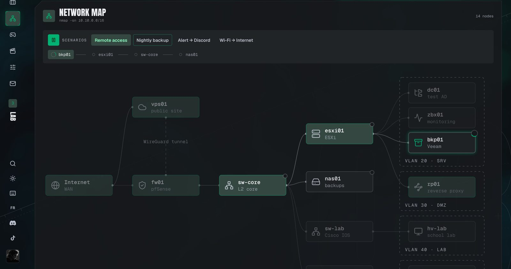
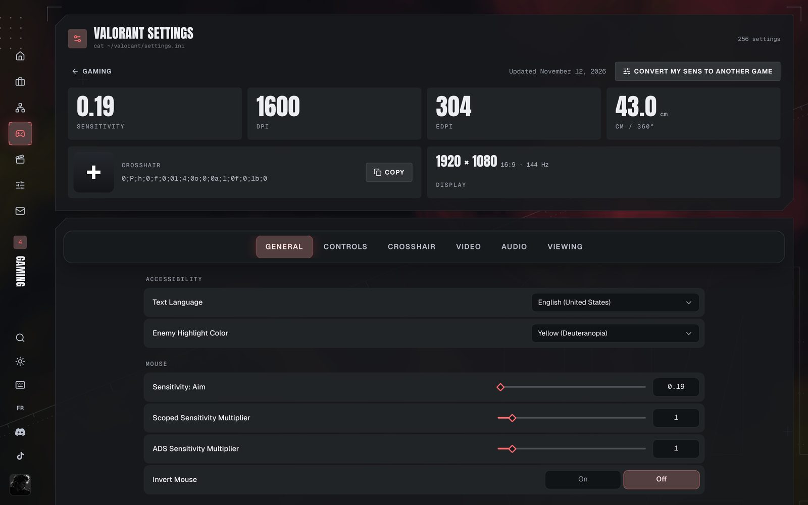
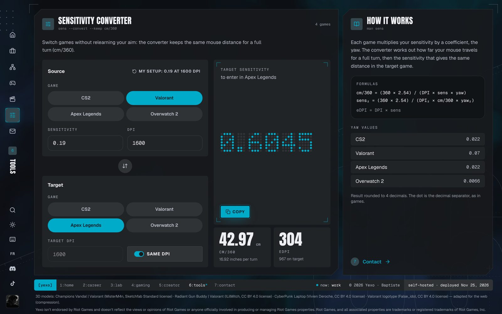

# yexofps.org · v1

Personal site of Baptiste, aka **Yexo**: IT infrastructure on one side, Valorant video editing on the other.
Designed and built from scratch, self-hosted on my own Ubuntu VPS.

> [!NOTE]
> This repository is the first version of the site: Anton titles, cut-corner cards, the Vandal in 3D.
> [yexofps.org](https://yexofps.org) has since moved to a new design.

**Next.js 16** · **React 19** · **TypeScript** · **Tailwind CSS v4** · **three.js** (React Three Fiber) · **next-intl** (FR / EN)

<table>
  <tr>
    <td width="50%"></td>
    <td width="50%"></td>
  </tr>
  <tr>
    <td align="center"><sub>Two profiles: <b>Yexo</b> (gaming, editing) and <b>Baptiste</b> (infrastructure)</sub></td>
    <td align="center"><sub>Homelab network map with replayable scenarios</sub></td>
  </tr>
  <tr>
    <td width="50%"></td>
    <td width="50%"></td>
  </tr>
  <tr>
    <td align="center"><sub>Valorant settings, laid out like the in-game menu</sub></td>
    <td align="center"><sub>Sensitivity converter that keeps the same cm/360</sub></td>
  </tr>
</table>

## Features

- **Seven spaces**: Home, Career, Lab, Gaming, Creator, Tools and Contact. Each one has a single accent color, turned
  into a full Material You palette; colors glide from one space to the next. Dark by default, light theme available.
- **Two profiles on the home page**: Yexo, the Valorant and editing side (`/`), and Baptiste, the infrastructure
  side (`/baptiste`), each with its own universe.
- **Live data**: Valorant tracker through the HenrikDev API (`/api/valorant`), live Discord presence and Spotify on
  `/now` through Lanyard (`/api/presence`), real server figures on “How this site is hosted” (`/api/host`).
- **Homelab**: an interactive SVG network map (role, neighbours and path of each node) whose scenarios replay real
  traffic, step by step.
- **Gaming**: ranks, every Valorant setting laid out like the in-game menu, and a sensitivity converter (cm/360)
  for CS2, Valorant, Apex Legends and Overwatch 2.
- **3D**: Vandal, laptop and Radiant buddy with React Three Fiber, loaded after first paint, rendered only on screen,
  frozen as a still frame without a GPU.
- **Keyboard**: `1`–`7` to switch spaces, `Ctrl`/`⌘` + `K` for the command palette, `?` for every shortcut.
- **Accessible**: everything is frozen with `prefers-reduced-motion`, AA contrast in both themes.

## Run it locally

Requires Node.js 20.9 or later.

```bash
npm ci
npm run dev
```

Then open http://localhost:3000.

The Valorant tracker needs a [HenrikDev](https://docs.henrikdev.xyz) API key in `.env.local` (never committed):

```bash
HENRIK_API_KEY=your_key
```

Without a key, the site still works: the tracker shows an “unavailable” state and the peak rank stays visible.

## Edit the content

| What | Where |
|------|-------|
| Accent colors (the whole palette derives from them) | `src/config/theme.ts` |
| Links, socials, products, ranks, setup, tracker account | `src/config/site.ts` |
| Homelab (machines, VMs, VLANs, map, scenarios) | `src/config/lab.ts` |
| Career (timeline, skills, missions, PDF guides) | `src/config/career.ts` |
| Weekly schedule behind the `/now` status | `src/config/now.ts` |
| Hosting details shown on `/lab/site` | `HOSTING` in `src/config/site.ts` (the rest is read live on the server) |
| Live Discord status | `DISCORD_USER_ID` in `src/config/site.ts`, recognised games in `PRESENCE_ACTIVITIES` (`src/config/now.ts`) |
| Valorant settings, crosshair, display | `src/config/valorant-settings.ts` (sensitivity and DPI: `MY_SENS` in `site.ts`) |
| Every text, in both languages | `messages/fr.json`, `messages/en.json` |

In `src/config/lab.ts`, every invented item carries `placeholder: true` and a `PLACEHOLDER` comment.

### Featured video

The home player reads a video hosted with the site, in `public/videos/` (nothing is requested from TikTok). It is
only downloaded when the player gets close to the viewport. Compress it first (720p, fast start, audio kept for the
sound button):

```bash
ffmpeg -i edit.mp4 -vf "scale=1280:720:flags=lanczos" -c:v libx264 -preset slow -crf 32 -profile:v high \
  -pix_fmt yuv420p -c:a aac -b:a 128k -movflags +faststart featured-edit-v3.mp4
```

Files in `public/videos/` and `public/models/` are cached for a year (`immutable`, see `next.config.ts`): to replace
one, give it a new file name (v3, v4…) and update its path in the config.

## Before deploying

```bash
npm run lint
npm run build
```

Both must pass without a single warning.

## Credits

- 3D models, adapted for the web (compression):
  [Champions Vandal | Valorant](https://sketchfab.com/3d-models/champions-vandal-valorant-98e52436582b44f9902716b8834784d6) by MisterM4n ([Sketchfab Standard](https://sketchfab.com/licenses)) ·
  [Radiant Gun Buddy | Valorant](https://sketchfab.com/3d-models/radiant-gun-buddy-valorant-740f4234ac52446fb67b19202e27dfeb) by ILilMitch ([CC BY 4.0](https://creativecommons.org/licenses/by/4.0/)) ·
  [CyberPunk Laptop](https://sketchfab.com/3d-models/cyberpunk-laptop-8330c89e8431451db3aa9d15c5836ddf) by Vivien Deroche ([CC BY 4.0](https://creativecommons.org/licenses/by/4.0/)) ·
  [Valorant logotype](https://sketchfab.com/3d-models/valorant-logotype-55d73adcba464fb787037368af8b761b) by False_idol ([CC BY 4.0](https://creativecommons.org/licenses/by/4.0/))
- Fonts: [Geist](https://vercel.com/font) and [Anton](https://fonts.google.com/specimen/Anton), both under the SIL Open Font License.
- Icons: [Lucide](https://lucide.dev).

Yexo isn't endorsed by Riot Games and doesn't reflect the views or opinions of Riot Games or anyone officially
involved in producing or managing Riot Games properties. Riot Games, and all associated properties are trademarks or
registered trademarks of Riot Games, Inc. After Effects is a trademark of Adobe.
